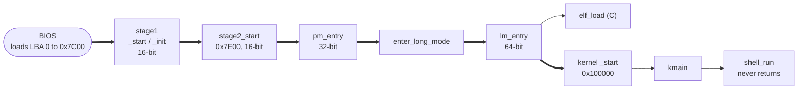
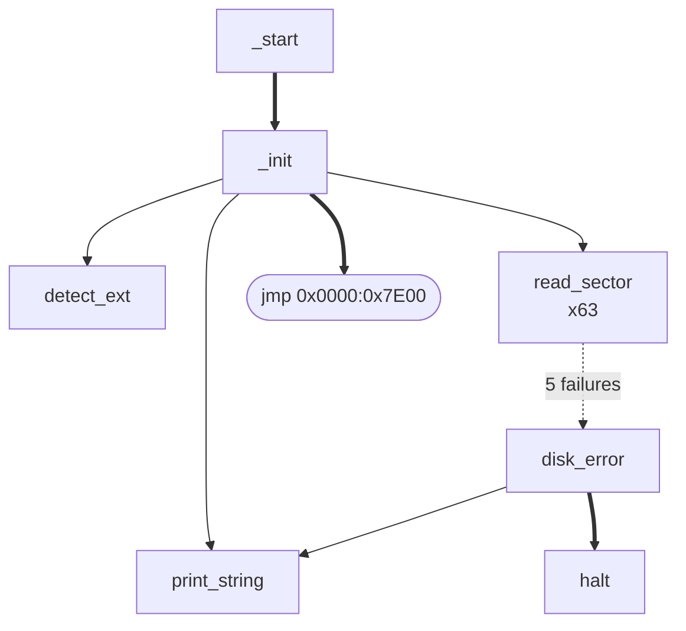
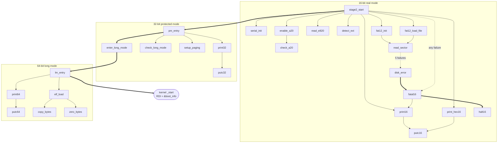
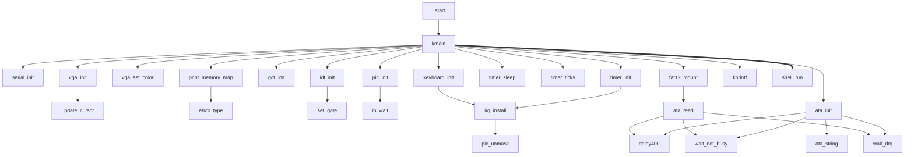
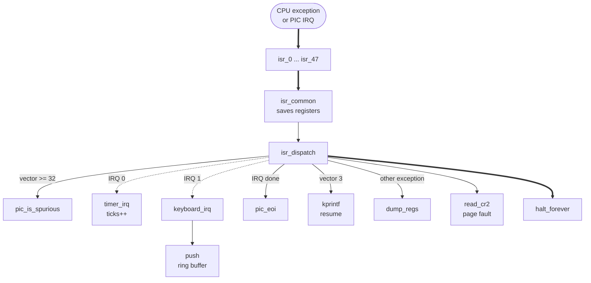
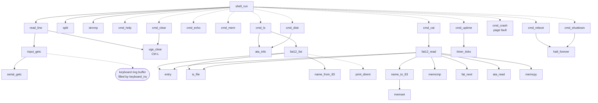
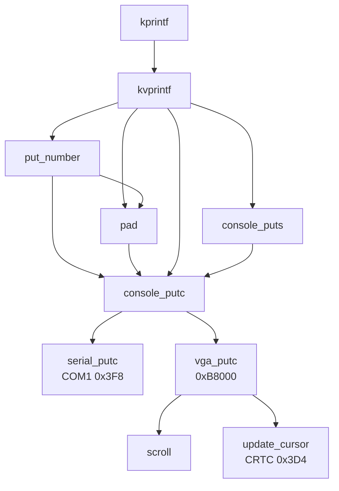
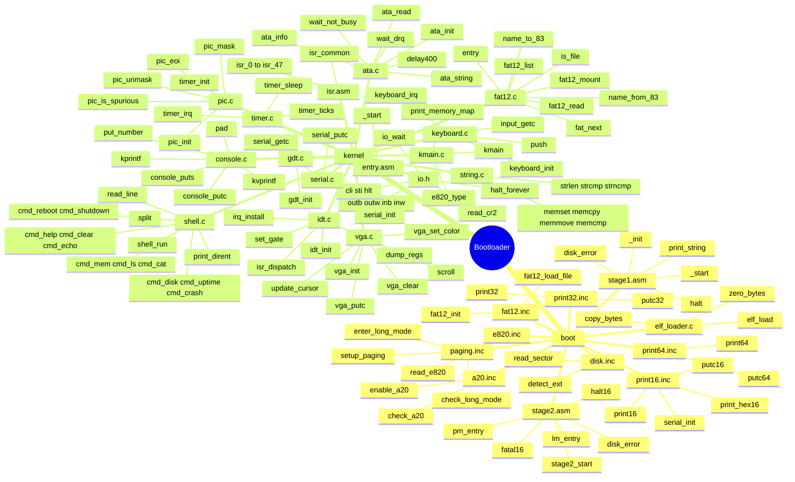

# Function call graphs and the function tree

How every function in the project is reached, from the BIOS jump to the
shell. C edges come from `gcc -fcallgraph-info`. Assembly edges and calls
through function pointers (dashed lines) come from the source.

- [1. The whole boot chain](#1-the-whole-boot-chain)
- [2. Stage1](#2-stage1)
- [3. Stage2](#3-stage2)
- [4. Kernel initialisation](#4-kernel-initialisation)
- [5. Interrupt path](#5-interrupt-path)
- [6. Shell](#6-shell)
- [7. Output funnel](#7-output-funnel)
- [8. Tree of all functions, by file](#8-tree-of-all-functions-by-file)
- [9. Full call tree (text)](#9-full-call-tree-text)

Legend for the flowcharts: solid arrow = direct call, thick arrow = jump that
never returns, dashed arrow = call through a function pointer.

---

## 1. The whole boot chain



## 2. Stage1



## 3. Stage2



## 4. Kernel initialisation



## 5. Interrupt path

Every interrupt enters through a generated stub; `isr_dispatch` decides what
to do with it.



## 6. Shell



## 7. Output funnel

All kernel output ends in `console_putc`, which feeds both COM1 and the
screen.



---

## 8. Tree of all functions, by file

Every function and routine in the project, grouped by directory and file.



---

## 9. Full call tree (text)

The same graph as one indented tree, in execution order. `⇒` is a jump that
does not return, `⇢` a call through a function pointer, and `…` means
the subtree was already expanded above. Port I/O helpers from `io.h`
(`inb`, `outb`, …) are left out to keep it readable.

```
BIOS ⇒ stage1 _start                                    boot/stage1.asm
└─ _init
   ├─ print_string
   ├─ detect_ext                                        boot/disk.inc
   ├─ read_sector  (×63: LBA 1..63 → 0x7E00)
   │  └─ disk_error ⇒ halt              (after 5 failed attempts)
   └─ ⇒ stage2_start                                    boot/stage2.asm
      ├─ serial_init                                    boot/print16.inc
      ├─ print16 ─ putc16
      ├─ print_hex16 ─ putc16
      ├─ enable_a20 ─ check_a20                         boot/a20.inc
      ├─ read_e820                                      boot/e820.inc
      ├─ detect_ext
      ├─ fat12_init ─ read_sector                       boot/fat12.inc
      ├─ fat12_load_file ─ read_sector
      ├─ fatal16 ─ print16, ⇒ halt16    (on any failure)
      └─ ⇒ pm_entry                     (CR0.PE, far jump 0x08)
         ├─ print32 ─ putc32                            boot/print32.inc
         ├─ check_long_mode                             boot/paging.inc
         ├─ setup_paging
         └─ ⇒ enter_long_mode           (PAE, LME, PG, far jump 0x18)
            └─ ⇒ lm_entry
               ├─ print64 ─ putc64                      boot/print64.inc
               ├─ elf_load                              boot/elf_loader.c
               │  ├─ copy_bytes
               │  └─ zero_bytes
               └─ ⇒ kernel _start       (RDI = &boot_info)  kernel/entry.asm
                  └─ kmain                              kernel/kmain.c
                     ├─ serial_init                     kernel/serial.c
                     ├─ vga_init ─ update_cursor        kernel/vga.c
                     ├─ vga_set_color
                     ├─ kprintf ─ kvprintf              kernel/console.c
                     │  ├─ put_number ─ pad, console_putc
                     │  ├─ pad ─ console_putc
                     │  ├─ console_puts ─ console_putc
                     │  └─ console_putc
                     │     ├─ serial_putc
                     │     └─ vga_putc ─ scroll, update_cursor
                     ├─ print_memory_map ─ e820_type, kprintf …
                     ├─ gdt_init                        kernel/gdt.c
                     ├─ idt_init ─ set_gate             kernel/idt.c
                     ├─ (int3 → interrupt path, see below)
                     ├─ pic_init ─ io_wait              kernel/pic.c
                     ├─ timer_init ─ irq_install ─ pic_unmask   kernel/timer.c
                     ├─ timer_sleep
                     ├─ timer_ticks
                     ├─ keyboard_init ─ irq_install …   kernel/keyboard.c
                     ├─ ata_init                        kernel/ata.c
                     │  ├─ delay400
                     │  ├─ wait_not_busy
                     │  ├─ wait_drq
                     │  └─ ata_string
                     ├─ ata_info
                     ├─ fat12_mount ─ ata_read          kernel/fat12.c
                     │                ├─ delay400, wait_not_busy, wait_drq
                     └─ ⇒ shell_run                     kernel/shell.c
                        ├─ console_puts …, vga_set_color, kprintf …
                        ├─ read_line
                        │  ├─ input_getc ─ serial_getc  (+ keyboard ring buffer)
                        │  ├─ console_putc …, console_puts …
                        │  └─ vga_clear ─ update_cursor
                        ├─ split
                        ├─ strcmp                       kernel/string.c
                        └─ ⇢ commands[].fn
                           ├─ cmd_help ─ kprintf …
                           ├─ cmd_clear ─ vga_clear …
                           ├─ cmd_echo ─ kprintf …
                           ├─ cmd_mem ─ kprintf …
                           ├─ cmd_ls ─ ata_info, kprintf …
                           │  └─ fat12_list ─ entry, is_file, name_from_83
                           │     └─ ⇢ print_dirent ─ kprintf …
                           ├─ cmd_cat ─ console_putc …, kprintf …
                           │  └─ fat12_read
                           │     ├─ name_to_83 ─ memset
                           │     ├─ entry, is_file, memcmp, memcpy
                           │     ├─ fat_next
                           │     └─ ata_read …
                           ├─ cmd_disk ─ ata_info, kprintf …
                           ├─ cmd_uptime ─ timer_ticks, kprintf …
                           ├─ cmd_crash ─ kprintf …  (read 0x40000000 → #PF)
                           ├─ cmd_reboot ─ kprintf …, ⇒ halt_forever
                           └─ cmd_shutdown ─ kprintf …, ⇒ halt_forever

Interrupt path (any time interrupts are on)             kernel/isr.asm
CPU ⇒ isr_N ⇒ isr_common
              └─ isr_dispatch                           kernel/idt.c
                 ├─ pic_is_spurious                     (IRQ 7 / 15)
                 ├─ ⇢ irq_handlers[irq]
                 │  ├─ timer_irq       (IRQ 0)          kernel/timer.c
                 │  └─ keyboard_irq ─ push   (IRQ 1)    kernel/keyboard.c
                 ├─ pic_eoi
                 ├─ kprintf …          (vector 3: breakpoint, resumes)
                 └─ vga_set_color, kprintf …, read_cr2, dump_regs ─ kprintf …,
                    ⇒ halt_forever     (any other exception)

Present but not called today: memmove, strlen, strncmp, pic_mask.
```
