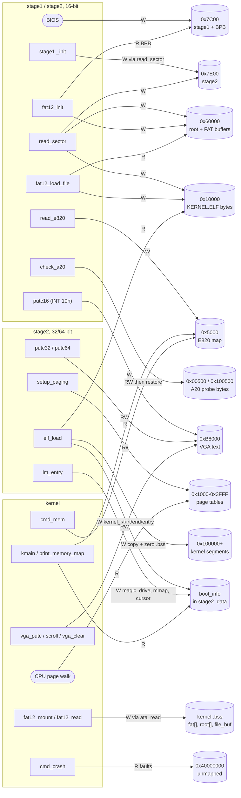
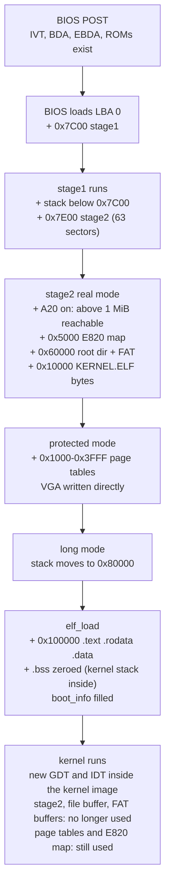
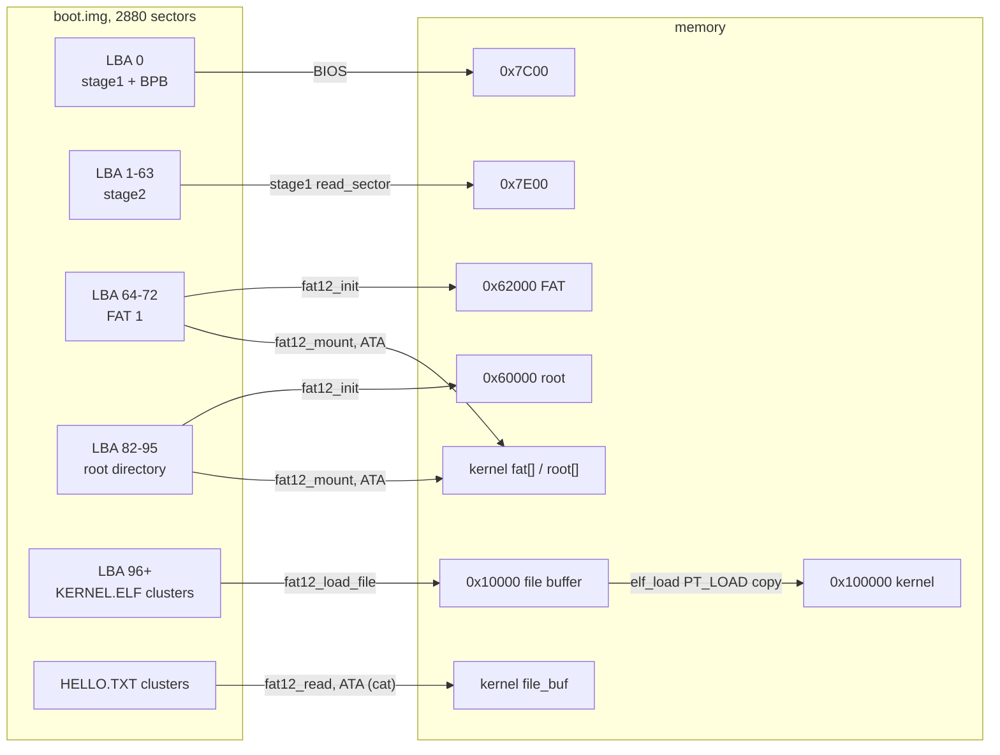
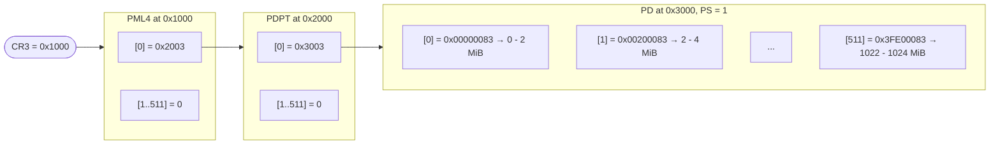
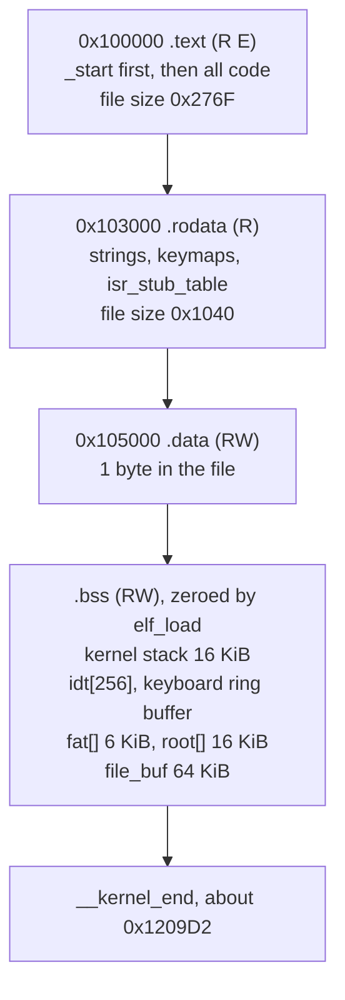
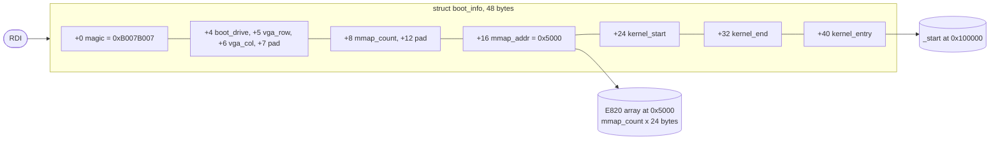
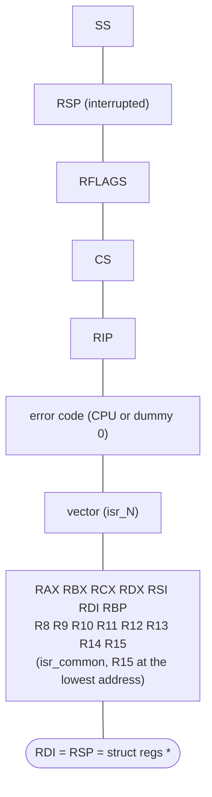

# Memory graph

Where everything lives in physical memory, who writes and reads each region,
and how the layout changes as the machine moves from the BIOS to the
kernel shell.

- [1. Physical memory map](#1-physical-memory-map)
- [2. Which function touches which memory](#2-which-function-touches-which-memory)
- [3. Memory over the boot timeline](#3-memory-over-the-boot-timeline)
- [4. Disk to memory](#4-disk-to-memory)
- [5. Page tables](#5-page-tables)
- [6. Kernel image at 1 MiB](#6-kernel-image-at-1-mib)
- [7. boot_info](#7-boot_info)
- [8. Interrupt stack frame](#8-interrupt-stack-frame)

All addresses are physical. Paging is an identity map, so virtual = physical
everywhere.

---

## 1. Physical memory map

Lowest address at the top.

```mermaid
flowchart TB
    subgraph LOW["Conventional memory, below 1 MiB"]
        direction TB
        ivt["0x00000 - 0x004FF<br/>IVT + BIOS Data Area<br/>(BIOS)"]
        free1["0x00500 - 0x00FFF<br/>free"]
        pt["0x01000 - 0x03FFF<br/>Page tables: PML4, PDPT, PD<br/>(setup_paging, used by the kernel forever)"]
        free2["0x04000 - 0x04FFF<br/>free"]
        e820["0x05000 - 0x055FF<br/>E820 map, up to 64 x 24 B<br/>(read_e820)"]
        stk16["0x05600 - 0x07BFF<br/>real/protected mode stack, grows down from 0x7C00"]
        s1["0x07C00 - 0x07DFF<br/>stage1 + BPB<br/>(BIOS loads it)"]
        s2["0x07E00 - 0x0FDFF<br/>stage2, up to 63 sectors<br/>(stage1 loads it)"]
        kbuf["0x10000 - 0x5FFFF<br/>KERNEL.ELF file buffer, max 320 KiB<br/>(fat12_load_file)"]
        fatb["0x60000 - 0x63FFF<br/>root directory 0x60000, FAT 0x62000<br/>(fat12_init)"]
        stk64["0x64000 - 0x7FFFF<br/>long mode stack, top 0x80000<br/>(lm_entry, elf_load)"]
        ebda["0x80000 - 0x9FFFF<br/>EBDA starts at 0x9FC00 in QEMU (reserved)"]
        vga["0xA0000 - 0xBFFFF<br/>video memory, text buffer at 0xB8000"]
        rom["0xC0000 - 0xFFFFF<br/>option ROMs, BIOS"]
        ivt --- free1 --- pt --- free2 --- e820 --- stk16 --- s1 --- s2 --- kbuf --- fatb --- stk64 --- ebda --- vga --- rom
    end
    subgraph HIGH["Above 1 MiB"]
        direction TB
        ktext["0x100000 kernel .text"]
        krod["0x103000 .rodata"]
        kdata["0x105000 .data + .bss<br/>stack 16 KiB, FAT cache, file_buf 64 KiB"]
        kend["about 0x1209D2 __kernel_end"]
        freeh["free RAM up to 0x7FDFFFF (128 MiB guest)"]
        idmax["0x3FFFFFFF end of the 1 GiB identity map<br/>cmd_crash reads 0x40000000"]
        ktext --- krod --- kdata --- kend --- freeh --- idmax
    end
    LOW --- HIGH
```

| Region | Size | Written by | Read by | Lifetime |
|--------|------|------------|---------|----------|
| `0x01000–0x03FFF` page tables | 12 KiB | `setup_paging` | CPU (CR3) | forever |
| `0x05000` E820 map | ≤ 1.5 KiB | `read_e820` | `print_memory_map`, `cmd_mem` | forever |
| `0x07C00` stage1 + BPB | 512 B | BIOS | `fat12.inc`, `disk.inc` (`bpb_*`) | until the kernel |
| `0x07E00` stage2 | ≤ 31.5 KiB | stage1 `_init` | CPU | until the kernel |
| `0x10000` kernel file | ≤ 320 KiB | `fat12_load_file` | `elf_load` | until the kernel |
| `0x60000` FAT12 buffers | 11.5 KiB | `fat12_init` | `fat12_load_file` | stage2 only |
| `0x80000` stack top | — | `lm_entry` | `elf_load` | stage2 only |
| `0xB8000` VGA text | 4000 B | `putc32`, `putc64`, `vga_putc` | the display | forever |
| `0x100000+` kernel | ≈ 130 KiB | `elf_load` | the kernel | forever |

---

## 2. Which function touches which memory

Functions on the left, memory regions on the right. `W` = writes,
`R` = reads, `RW` = both.

---

## 3. Memory over the boot timeline

Each step adds or retires regions. Once the kernel runs, everything below
`0x10000` except the page tables, the E820 map and the BIOS areas is dead
space it may reuse.

---

## 4. Disk to memory

What gets copied from which LBA to which address, and by whom.

---

## 5. Page tables

Built by `setup_paging`, loaded into `CR3` by `enter_long_mode`, kept by the
kernel. Three tables map 1 GiB with 2 MiB pages.

A virtual address `V < 1 GiB` decodes as PML4 index 0, PDPT index 0, PD
index `V >> 21`, offset `V & 0x1FFFFF`, giving the physical address `V`.
Anything at or above `0x40000000` hits an empty PDPT entry and page-faults,
which is exactly what `cmd_crash` shows.

---

## 6. Kernel image at 1 MiB

From `readelf -lW build/kernel.elf`, as placed by `elf_load`:

The third `PT_LOAD` has `p_filesz = 0x1` and `p_memsz = 0x1B9D2`: one byte of
`.data`, then about 110 KiB of `.bss` that `elf_load` zero-fills.

---

## 7. boot_info

Filled by `lm_entry` and `elf_load` inside stage2's `.data`; the kernel
receives its address in `RDI`.

---

## 8. Interrupt stack frame

What `isr_dispatch` sees through its `struct regs *` argument. Highest
address at the top: the CPU pushes first, the stub second, `isr_common` last.

| Pushed by | Fields |
|-----------|--------|
| CPU | `ss`, `rsp`, `rflags`, `cs`, `rip`, and for some exceptions `error` |
| `isr_N` stub | dummy `error` (if needed), `vector` |
| `isr_common` | `rax` … `r15` |
